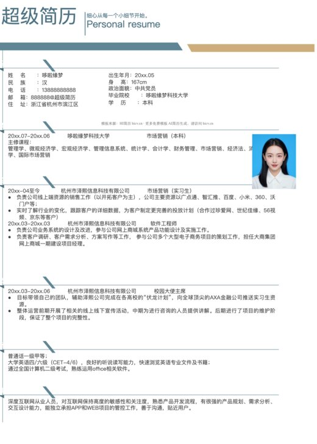
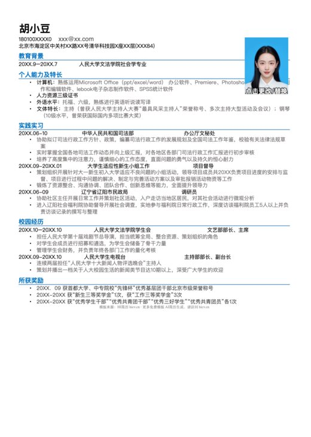
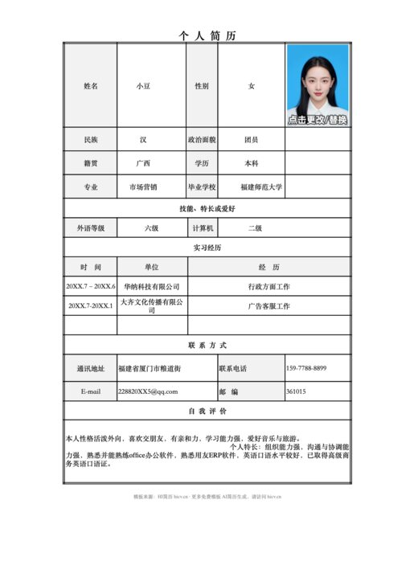
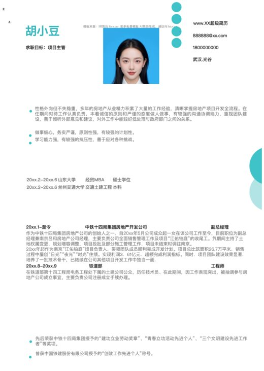
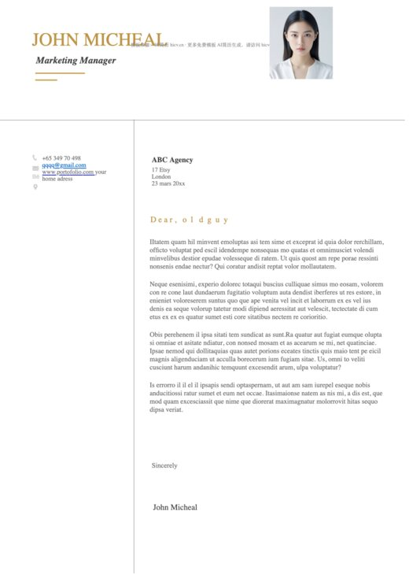
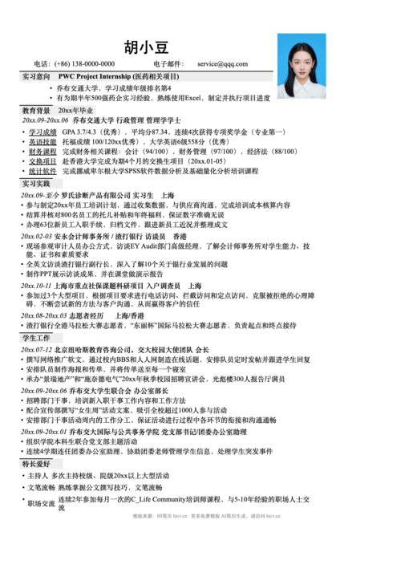

# HICV 简历模板库：2,132 套 Word 简历模板免费下载

**每一次来之不易的求职机会，都值得一份认真准备的简历。**

HICV 根据用户反馈持续打磨模板预览、样式调整与导出体验，帮助你更清楚地呈现关键经历，把精力放在岗位匹配和投递准备上。你可以查看 [用户反馈与公开迭代记录](https://hicv.cn/updates?utm_source=github&utm_medium=referral&utm_campaign=word_resume_templates&utm_content=readme_trust_updates)，了解具体改进。

这里整理了 2,132 套可编辑 Word 简历模板，覆盖中文个人简历、应届生简历、表格简历、行业岗位简历、研究生复试简历、自荐信和英文简历等常见求职场景。

模板均为 `.docx` 格式，可使用 Microsoft Word、WPS Office 或兼容 DOCX 的编辑器打开修改。

**[在线浏览模板并制作简历](https://hicv.cn/templates?utm_source=github&utm_medium=referral&utm_campaign=word_resume_templates&utm_content=readme_primary)** · [搜索全部 Word 模板](https://hicv-cn.github.io/hicv-word-resume-templates/catalog/) · [查看完整模板索引](./TEMPLATE_INDEX.md)

## 2026 年 10 月更新

本次保留原有 2,132 套 DOCX，新增完整目录搜索与 3 篇简历指南。专题页也可搜索全部收录文件，不再只覆盖前 60 套。

| 你正在准备什么 | 免费 Word 模板与指南 | HICV 在线资源 |
| --- | --- | --- |
| 2027 届秋招 / 校招 | [秋招投递检查清单](https://hicv-cn.github.io/hicv-word-resume-templates/guides/campus-resume-checklist/) · [校招 Word 模板](https://hicv-cn.github.io/hicv-word-resume-templates/categories/campus-recruitment/) | [校招在线模板](https://hicv.cn/templates/category/xiaozhao?utm_source=github&utm_medium=referral&utm_campaign=word_resume_templates&utm_content=readme_october_campus) |
| 第一份实习，经历较少 | [没有实习经历怎么写](https://hicv-cn.github.io/hicv-word-resume-templates/guides/resume-without-internship/) · [实习 Word 模板](https://hicv-cn.github.io/hicv-word-resume-templates/categories/internship-entry-level/) | [实习生在线模板](https://hicv.cn/templates/category/shixisheng?utm_source=github&utm_medium=referral&utm_campaign=word_resume_templates&utm_content=readme_october_internship) |
| 已下载，准备排版与投递 | [Word / WPS 排版与 PDF 检查](https://hicv-cn.github.io/hicv-word-resume-templates/guides/word-resume-pdf-checklist/) | [按岗位参考简历范文](https://hicv.cn/fanwen?utm_source=github&utm_medium=referral&utm_campaign=word_resume_templates&utm_content=readme_october_examples) |

指南中的 2027 届指毕业年份，2026 年秋季指准备与投递时间。招聘对象、格式和截止时间请以企业公告为准。

## 百变模板：在线调整简历版式

HICV.cn 模板列表页已上线百变模板功能，可自由组合简历头部布局、模块样式、主题配色和页面背景。用同一份简历内容，就能快速切换简约清爽、正式商务等不同投递风格。

**[试试 HICV 百变模板](https://hicv.cn/templates?utm_source=github&utm_medium=referral&utm_campaign=word_resume_templates&utm_content=readme_baibian_template)** · [查看演示视频](https://prod-oss.hicv.cn/template/baibian-video-900-30fps.mp4)

## 在线模板与 Word 怎么选

想快速换版式、在线编辑并导出 PDF，建议先试 [HICV 在线模板](https://hicv.cn/templates?utm_source=github&utm_medium=referral&utm_campaign=word_resume_templates&utm_content=readme_choice_online)；需要离线编辑或按招聘要求提交 DOCX，再选择下方 Word 文件。

| 对比 | HICV 在线模板 | Word / WPS 文件 |
| --- | --- | --- |
| 版式调整 | 百变模板可组合头部、模块、配色与背景 | 自由调整表格、段落与页面，需要一定排版经验 |
| 内容完善 | 在线编辑，可结合 AI 帮写；仍需核对事实 | 自行整理与修改内容 |
| 投递文件 | 适合制作后导出 PDF，仍需逐页检查 | 适合要求 DOCX 的投递，也可自行导出 PDF |
| 使用条件 | 依赖网络，相关功能可能需要登录 | 下载后可在本地兼容编辑器中离线修改 |
| 费用与限制 | 免费与高级模板权益不同，部分 AI 功能有额度或会员限制 | 仓库 DOCX 免费，使用与转发请保留来源信息 |

在线功能及费用以 [官网权益说明](https://hicv.cn/pricing?utm_source=github&utm_medium=referral&utm_campaign=word_resume_templates&utm_content=readme_choice_pricing) 和账户内提示为准。在线模板与仓库 DOCX 并非一一对应。

## 真实模板预览

以下图片由仓库中的 DOCX 文件直接渲染。点击图片可查看对应文件。

<table>
  <tr>
    <td align="center"> 简约单页 001</td>
    <td align="center"> 极简蓝色单页</td>
    <td align="center"> 表格单页 001</td>
  </tr>
  <tr>
    <td align="center"> 项目管理单页</td>
    <td align="center"> 英文单页 001</td>
    <td align="center"> 四大实习模板</td>
  </tr>
</table>

## 按类型找模板

- [简约单页 Word 简历模板](https://hicv-cn.github.io/hicv-word-resume-templates/categories/minimalist-single-page/)
- [表格 Word 简历模板](https://hicv-cn.github.io/hicv-word-resume-templates/categories/table-resume/)
- [职业岗位 Word 简历模板](https://hicv-cn.github.io/hicv-word-resume-templates/categories/professional-resume/)
- [行业专属 Word 简历模板](https://hicv-cn.github.io/hicv-word-resume-templates/categories/industry-resume/)
- [英文 Word 简历模板](https://hicv-cn.github.io/hicv-word-resume-templates/categories/english-resume/)
- [研究生复试 Word 简历模板](https://hicv-cn.github.io/hicv-word-resume-templates/categories/postgraduate-interview/)

## 求职场景专题

以下专题页复用仓库现有模板，按求职场景整理，支持在完整专题中搜索：

- [秋招校招 Word 简历模板](https://hicv-cn.github.io/hicv-word-resume-templates/categories/campus-recruitment/)
- [实习与应届生 Word 简历模板](https://hicv-cn.github.io/hicv-word-resume-templates/categories/internship-entry-level/)
- [教师教育行业 Word 简历模板](https://hicv-cn.github.io/hicv-word-resume-templates/categories/teacher-resume/)
- [金融财务 Word 简历模板](https://hicv-cn.github.io/hicv-word-resume-templates/categories/finance-resume/)
- [设计视觉 Word 简历模板](https://hicv-cn.github.io/hicv-word-resume-templates/categories/design-resume/)
- [技术开发 Word 简历模板](https://hicv-cn.github.io/hicv-word-resume-templates/categories/technology-resume/)

## 模板分类

### 新增类型入口

- 页数：[双页简历](https://hicv-cn.github.io/hicv-word-resume-templates/categories/two-page-resume/) · [三页与多页](https://hicv-cn.github.io/hicv-word-resume-templates/categories/multi-page-resume/)
- 风格：[活泼明朗](https://hicv-cn.github.io/hicv-word-resume-templates/categories/lively-resume/) · [简约优雅](https://hicv-cn.github.io/hicv-word-resume-templates/categories/elegant-resume/) · [文艺清新](https://hicv-cn.github.io/hicv-word-resume-templates/categories/fresh-resume/) · [稳重大气](https://hicv-cn.github.io/hicv-word-resume-templates/categories/formal-resume/) · [小红书风格](https://hicv-cn.github.io/hicv-word-resume-templates/categories/xiaohongshu-style/) · [创意彩色](https://hicv-cn.github.io/hicv-word-resume-templates/categories/creative-resume/)
- 岗位：[医疗护理](https://hicv-cn.github.io/hicv-word-resume-templates/categories/medical-nursing/) · [运营电商](https://hicv-cn.github.io/hicv-word-resume-templates/categories/operations-ecommerce/) · [行政人事](https://hicv-cn.github.io/hicv-word-resume-templates/categories/hr-administration/) · [销售市场](https://hicv-cn.github.io/hicv-word-resume-templates/categories/sales-marketing/)
- 配套：[简历封面](https://hicv-cn.github.io/hicv-word-resume-templates/categories/resume-cover/) · [自荐信与求职信](https://hicv-cn.github.io/hicv-word-resume-templates/categories/cover-letter/)

### 文件分类数量

| 分类 | 适用场景 | 数量 |
| --- | --- | ---: |
| 表格简历 | 传统表格式简历，适合信息密度高、稳妥清晰的中文简历 | 118 |
| 简约简历 | 现代简约风格，覆盖单页、双页、三页、四页等版式 | 897 |
| 封面页 | 独立简历封面，可搭配多页简历或求职材料使用 | 28 |
| 活泼明朗 | 校招、实习、创意岗位等更年轻的简历风格 | 18 |
| 简约优雅 | 行政、运营、职能类岗位常用的清爽简历版式 | 29 |
| 文艺清新 | 教育、传媒、内容、设计等方向的清新风格模板 | 20 |
| 稳重大气 | 管理、金融、咨询、成熟职场场景的正式简历 | 25 |
| 职业风格 | 通用求职、办公岗位、职业化岗位简历模板 | 102 |
| 行业专属 | 教师、医学、财务、销售、技术、运营等行业简历 | 496 |
| 小红书风格 | 更适合社媒审美和年轻求职者的视觉简历 | 29 |
| 英文简历 | 英文简历、英文 CV、外企和留学申请相关模板 | 81 |
| 研究生复试 | 复试简历、调剂申请表、研究生面试材料 | 32 |
| 小升初自我介绍 | 学生自我介绍、成长展示、小升初材料 | 17 |
| 其他风格 | 莫兰迪、古风、艺术气质、现代时尚等创意模板 | 223 |
| 自荐信与范文 | 自荐信、求职信、简历范文和配套文书 | 17 |

## 使用方式

1. 进入 [模板搜索页](https://hicv-cn.github.io/hicv-word-resume-templates/catalog/) 或 [完整模板索引](./TEMPLATE_INDEX.md)。
2. 按名称、分类或岗位查找 `.docx` 文件。搜索页支持多个关键词，例如“会计 单页”。
3. 下载后用 Word 或 WPS 修改个人信息、教育经历、实习经历和项目经历。
4. 按招聘方要求提交 DOCX 或 PDF；导出后逐页检查分页、字体、链接及残留示例内容。

搜索页的“下载 DOCX”直接链接原文件。若所在网络无法访问下载地址，可以在 [GitHub 文件目录](./templates) 打开同名文件后下载。在线模板与仓库 DOCX 是两种使用方式，不代表每份 Word 文件都有一一对应的在线版本。

需要在线套用模板、检查经历表达或根据目标岗位优化内容，可进入 [HICV 在线简历模板](https://hicv.cn/templates?utm_source=github&utm_medium=referral&utm_campaign=word_resume_templates&utm_content=readme_bottom)。

## 更新与反馈

- 版本更新见 [Releases](https://github.com/HICV-CN/hicv-word-resume-templates/releases)。
- 模板目录由 `scripts/generate-site.mjs` 统一生成，站点与索引会保持同步。
- 如有模板分类或文件问题，请提交 [Issue](https://github.com/HICV-CN/hicv-word-resume-templates/issues)。

## 授权说明

模板可免费使用和转发，请保留 [HICV.cn](https://hicv.cn?utm_source=github&utm_medium=referral&utm_campaign=word_resume_templates&utm_content=readme_license) 来源信息。详见 [LICENSE](./LICENSE)。
